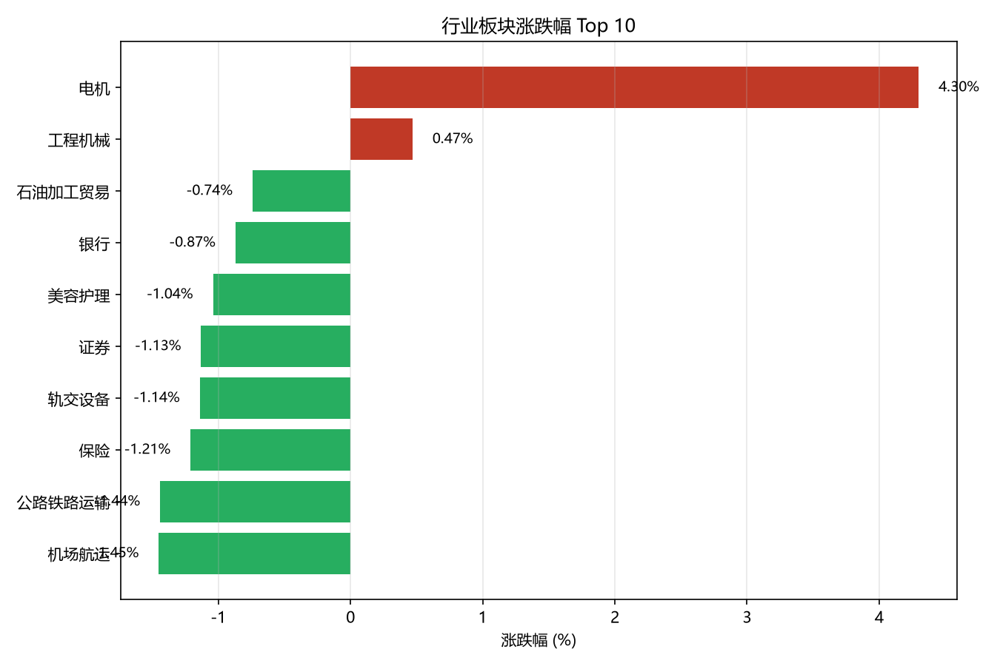

# 行业板块行情分析

## 数据

| 项目 | 内容 |
|---|---|
| 数据源 | 同花顺行业板块（akshare `stock_board_industry_summary_ths`） |
| 抓取时间 | 2026-10-22 21:06:47 |
| 快照文件 | `data/industry_20261022_210647.csv`（`latest.csv` 为同一份） |
| 数据量 | 90 行 × 7 个业务字段 |
| 字段 | 板块名称、涨跌幅、上涨家数、下跌家数、总市值、换手率、成交额 |

> ⚠️ 本数据源不含「总市值」和「换手率」两个字段，因此相关分析改用「成交额」替代，
> 并在下文逐处标注。分析脚本 `analyze.py` 会自动检测字段是否可用，缺失时降级而非报错。

## 结论

### 1. 市场整体：极端普跌

90 个行业板块中 **上涨 2 个、下跌 88 个、平盘 0 个，下跌占比 97.8%**，
涨跌幅区间 -6.52% ~ +4.30%。

仅有的 2 个上涨板块：电机 +4.30%、工程机械 +0.47%。

> 注：因为全市场只有 2 个板块上涨，所谓「涨幅榜前 5」中有 3 个实际是下跌的，
> 本质上是「跌幅最小的 5 个」。原始表述在此行情下会误导读者。

涨幅前 5 名：

| 排名 | 板块 | 涨跌幅 |
|---|---|---|
| 1 | 电机 | +4.30% |
| 2 | 工程机械 | +0.47% |
| 3 | 石油加工贸易 | -0.74% |
| 4 | 银行 | -0.87% |
| 5 | 美容护理 | -1.04% |

### 2. 涨跌幅与交易活跃度的关系

涨跌幅与成交额的相关系数为 **-0.135**，属弱负相关：
成交额越大的板块，倾向于跌得越多，但关系并不紧密。

（原分析使用「换手率」，本数据源无此字段，改用「成交额」作为交易活跃度的代理指标。）

### 3. 成交额 Top5 的涨跌情况

成交额最大的 5 个板块 **全部下跌（0 / 5 上涨）**：

| 板块 | 成交额（亿元） | 涨跌幅 |
|---|---|---|
| 半导体 | 1901.86 | -2.96% |
| 通信设备 | 1192.75 | -3.85% |
| 元件 | 796.29 | -5.38% |
| 电池 | 531.47 | -2.82% |
| 通用设备 | 490.21 | -1.81% |

这 5 个板块合计成交 **4912.6 亿元**，占全市场 15418.6 亿元的 **31.9%**。
资金高度集中在跌幅最大的科技制造板块 —— 典型放量下跌。

## 发现的问题

- **数据源字段不一致**：同花顺缺「总市值」「换手率」，东方财富有但板块数为 496（口径更细）。
  两个源的板块划分不同（90 vs 496），跨源比较必须先统一口径，否则结论不可比。
- **字段存在 ≠ 字段有值**：`latest.csv` 里「总市值」「换手率」两列是存在的，但值全为空。
  如果直接 `df['总市值']`，排序会退化成「不排序」，产出看似正常、实则错误的 Top5。
  `analyze.py` 中的 `pick()` 函数用两个条件（列存在 + 非全空）来防止这类静默错误。
- **极端行情下的表述陷阱**：单日普跌时，「涨幅榜」的语义失效。
  结论必须同时给出涨跌分布，否则读者会把「跌幅最小」误读成「上涨」。

## 局限与下一步

- **数据维度：只有单日横截面，没有时间维度。** 所有结论仅描述当日状态；无法计算变化率，
  因此不支持任何「趋势」「资金流向」「转向」类判断。要做趋势分析，至少需要连续多日快照
  ——现有的 `data/industry_*.csv` 快照机制已能支撑，缺的只是定时采集。
- **指标代理：用成交额代替换手率，存在系统性偏差。** 换手率 = 成交量 ÷ 流通股本（比例），
  成交额 = 成交量 × 平均价（金额）。后者既受价格影响，也没有除以股本，因此「成交额 Top5」
  排序接近「规模 Top5」而不是「活跃度 Top5」。更严谨的替代是「成交额 ÷ 流通市值」，
  但本数据源不提供流通市值。
- **统计检验：相关结论不具备显著性。** 涨跌幅与成交额的相关系数 -0.135，n=90，
  检验得 p≈0.20，在 0.05 水平下不显著，不足以支持「两者存在关联」的判断。
  下一步应补充 p 值报告，或改用更稳健的方法（Spearman 秩相关、分组对比）。
- **口径固定：跨数据源不可比。** 东方财富为多层级行业分类（496 行，同一行业在不同粒度
  重复出现），同花顺为单一层级（90 行）。Top 榜在两种口径下不可直接比较。
  下一步应固定单一数据源，或建立口径映射表。
- **工程化缺口：无定时采集、无自动测试。** 数据依赖手工运行 `update.py`，无法保证每日更新；
  代码改动后也没有断言校验，只能靠人工看输出。下一步应加入调度（每日收盘后运行）
  与基础校验断言（行数 > 0、涨跌幅落在合理区间等）。

## 如何复现

```
python update.py     # 抓数据 → data/latest.csv
python analyze.py    # 三个问题的分析
python chart.py      # 生成 top10.png
```

`analyze.py` 与 `chart.py` 只读本地 CSV，不联网；只有 `update.py` 需要网络。
数据源不可用时，`update.py` 会自动切换备用源；全部失败则保留上次快照并提示。

## 环境

- Python 3.14.5（C:\Python314），虚拟环境 `.venv`
- pandas 3.0.6 / matplotlib 3.11.2 / akshare 1.19.1
- Windows 10 + VS Code
