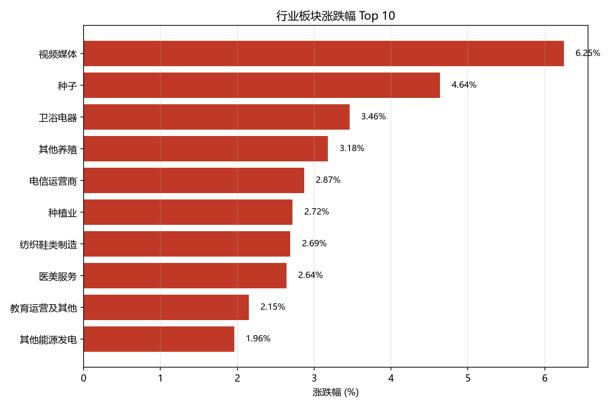

# 行业板块行情分析

抓 A 股行业板块的**单日行情快照**，落地成本地 CSV，下游脚本离线分析出涨跌分布、涨跌幅与成交额的关系、成交额集中度，并生成一张 Top 10 图。

一条原则贯穿全项目：**只有 `update.py` 联网，其余脚本只读本地快照**。数据源挂了不影响分析和出图。

## 目录结构

```
PLAN.md       学习路径与阶段验收（本项目的路线图，先看这个）
update.py     抓取 → data/*.csv            唯一联网的脚本
analyze.py    读快照，输出三段分析          不联网
chart.py      读快照，画 top10.png          不联网
stats.py      从快照算出报告要用的数字（分布 / 相关系数 / p 值）
check.py      环境与依赖自检
data/         industry_YYYYMMDD_HHMMSS.csv 快照 + latest.csv（最新一份）
reports/      每次快照的结论归档，一个快照一篇
```

## 数据

| 项目 | 内容 |
|---|---|
| 主源 | 东方财富 `stock_board_industry_name_em`：496 个细分板块，含总市值、换手率 |
| 备源 | 同花顺 `stock_board_industry_summary_ths`：90 个一级行业，缺总市值、换手率 |
| 降级规则 | 主源失败自动切备源；两源都失败则保留上次快照并提示，不删旧数据 |
| 当前快照 | `data/latest.csv`（抓取时间见该文件的「抓取时间」列） |
| 标准字段 | 板块名称、涨跌幅、上涨家数、下跌家数、总市值、换手率、成交额 |

> ⚠️ **口径不同，跨源数字不可直接比较。** 东财 496 行是多层级分类（同一行业在不同粒度重复出现），
> 同花顺 90 行是单一层级。同一数据源的不同日期可以比较；不同数据源之间不行。



## 快照报告

每次抓完存一份结论，不改写历史 —— 否则 README 里的数字会随数据一起过期：

- `reports/20261022.md` —— 2026-10-22 快照（同花顺，90 行）：普跌日，90 个板块里 88 个下跌
- `reports/20261024.md` —— 2026-10-24 快照（同花顺，90 行）：普涨日 + 与 10/22 的两日对比

## 口径与陷阱

- **数据源字段不一致**：同花顺缺「总市值」「换手率」，东方财富有但板块数为 496（口径更细）。
  两个源的板块划分不同（90 vs 496），跨源比较必须先统一口径，否则结论不可比。
- **字段存在 ≠ 字段有值**：`latest.csv` 里「总市值」「换手率」两列是存在的，但值全为空。
  如果直接 `df['总市值']`，排序会退化成「不排序」，产出看似正常、实则错误的 Top5。
  `analyze.py` 中的 `pick()` 用两个条件（列存在 + 非全空）来防止这类静默错误。
- **极端行情下的表述陷阱**：单日普跌时，「涨幅榜」的语义失效。结论必须同时给出涨跌分布，
  否则读者会把「跌幅最小」误读成「上涨」。
- **成交额 ≠ 活跃度**：换手率是比例（成交量 ÷ 流通股本），成交额是金额（成交量 × 均价）。
  用成交额排序得到的是「规模最大」而不是「换手最活跃」。更严谨的代理是「成交额 ÷ 流通市值」，
  但本数据源不提供流通市值。

## 局限与下一步

- **只有单日横截面，没有时间维度。** 所有结论仅描述当日状态；无法计算变化率，
  因此不支持任何「趋势」「资金流向」「转向」类判断。快照机制已能支撑时序分析，缺的只是定时采集。
- **两个采样点不构成趋势。** 10/22 与 10/24 同源（同花顺 90 行）可以比较分布变化，
  但方向性结论至少要连续 20 个交易日。
- **相关分析必须同时报 r、R²、p 值。** 只报 r 会高估关系强度：本数据 r≈0.27 时 R² 仅 0.073，
  即成交额只能解释涨跌幅 7.3% 的变异。`stats.py` 已同时输出三者。
  下一步可改用更稳健的方法（Spearman 秩相关、分组对比）。
- **自动采集：计划任务 day01_update，交易日 15:35 跑 update.py
- **测试：pytest -q → 4 个（3 个纯函数 + 1 个数据校验）
- **数据校验带 skipif，没有 CSV 时自动 skip 而不是崩

## 如何复现

```
python update.py                    # 抓数据 → data/latest.csv（需联网）
python analyze.py                   # 三段分析
python chart.py                     # 生成 top10.png
python stats.py data/latest.csv     # 报告要用的分布 / 相关系数 / p 值
```

`analyze.py`、`chart.py`、`stats.py` 只读本地 CSV，不联网；只有 `update.py` 需要网络。
数据源不可用时，`update.py` 会自动切换备用源；全部失败则保留上次快照并提示。

## 环境

- Python 3.14.5，虚拟环境 `.venv`（调用方式：`.venv\Scripts\python.exe update.py`）
- pandas 3.0.6 / matplotlib 3.11.2 / akshare 1.19.1
- Windows 10 + VS Code

## 维护约定

- **文档只写判据和坑**：为什么这样做、踩过什么坑、口径怎么选。看代码/看数据就能知道的内容不写进来。
- 过程、实测输出、失败明细写 `reports/`；本文件只保留能当验收标准的句子。
